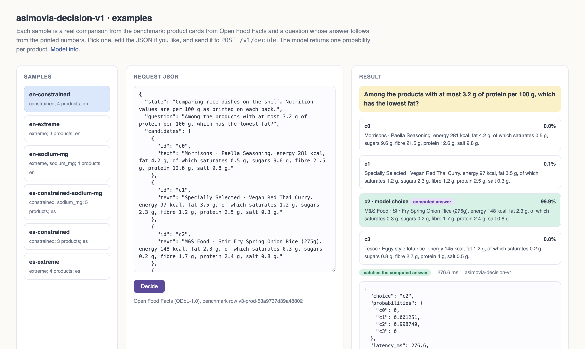
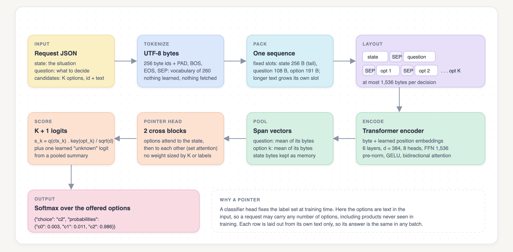
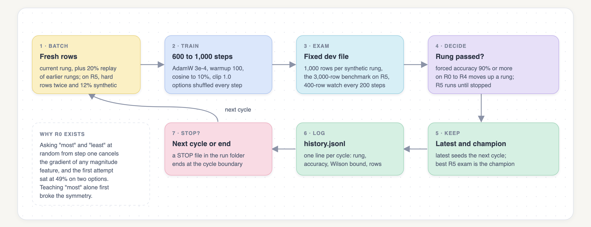
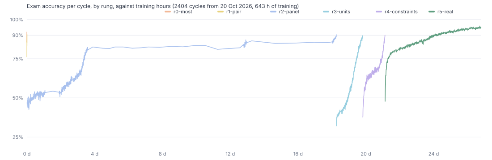
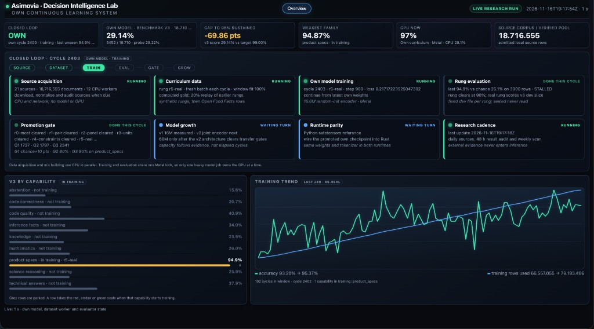
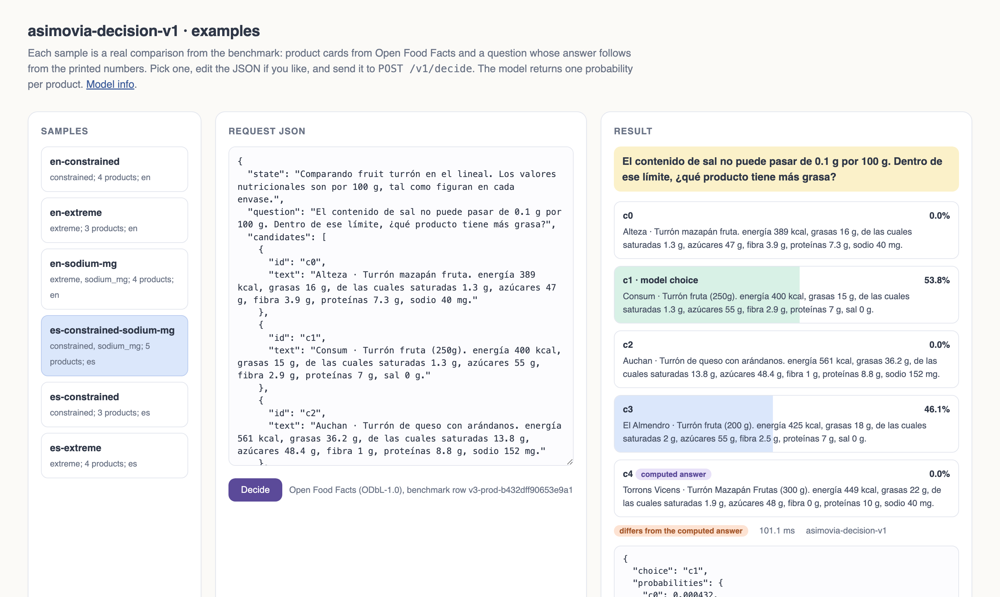
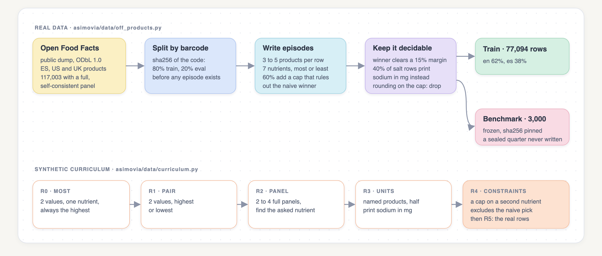

# asimovia-decision-v1

**A 17-million-parameter decision model, trained from random weights on one laptop.** It reads a
situation, a question and a set of free-text options as raw UTF-8 bytes and returns one
probability per option. Its one skill is comparing real food products by their printed nutrition
panels, in English and Spanish. On a frozen 3,000-question benchmark it picks the right product
**96.9%** of the time (chance is 26.1%), in about 22 ms per decision.

[](https://github.com/capitaharlock/jev-clone/actions/workflows/ci.yml)
[](LICENSE)
[](benchmark/README.md)
[](pyproject.toml)



This is a research artifact, not a product. It shows that a small Transformer with no pretraining,
no fitted tokenizer and no teacher model can learn to read and compare structured text, when the
labels are exact and the curriculum adds one difficulty at a time. A general decision model would
need orders of magnitude more data generation and compute than this project had.

**Contents:** [Results](#results) · [How it works](#how-it-works) · [Training](#training) ·
[Evaluation](#evaluation) · [Data](#data) · [Quick start](#quick-start) ·
[Reproduce](#reproduce) · [Repository](#repository) · [Limits](#limits)

## Results

Forced accuracy on the frozen benchmark: every system must pick one of the offered products.

| System | What it is | Rows | Accuracy | p50 latency |
|---|---|---:|---:|---:|
| Rule program | hand-written parser of these exact templates (the ceiling) | 3,000 | 99.2% | 0.05 ms |
| **asimovia-decision-v1** | **this repository, 17 M parameters, random init** | 3,000 | **96.9%** | 22 ms (M5 Pro GPU), 67 ms (CPU) |
| Qwen3.6-35B-A3B | general chat model through Ollama, Q4_K_M, zero-shot, answers one letter | 601 | 91.7% | 589 ms (M5 Pro GPU) |
| TinyJev-0.6B | Qwen3-0.6B-Base plus pointer head, latest revision `c559c2f` | 3,000 | 36.1% | 36 ms (M5 Pro GPU) |
| Uniform guess | | | 26.1% | |

- **The rule program is the ceiling, not a rival.** It knows the question templates and solves
  every row whose answer the text decides. 25 benchmark rows (0.8%) are not decidable from the
  printed text; see [Data](#data).
- **Unbiased number.** The checkpoint was picked as the best training cycle on this benchmark. On
  2,162 further rows that never took part in any choice
  (`benchmark/product_specs.validation.jsonl`) it scores **96.2%** (Wilson 95% lower bound 95.3%).
- **Qwen ran on a 601-row stratified subset** (every cell of difficulty, option count and language
  kept in proportion), because it takes about a second per decision. On those same 601 rows this
  model scores 96.3%. Most of Qwen's misses are unit conversion: 94.4% when the question asks for
  salt in grams, 60.4% when it asks for sodium in mg and the cards print salt.
- **What the comparison measures.** TinyJev and Qwen are general models never trained on nutrition
  panels; this one knows nothing else. The table shows what training on the task buys a model 35
  to 2,000 times smaller, not which model is better.

Where it still fails, by question shape (benchmark, 3,000 rows):

| Shape | Accuracy |
|---|---:|
| "Which has the most / least X" | 99.0% |
| Same, with a cap on a second nutrient that excludes the naive winner | 91.3% |
| 3 / 4 / 5 products | 98.5% / 97.1% / 94.3% |
| Salt asked in g / sodium asked in mg | 97.4% / 91.2% |
| English / Spanish | 97.4% / 96.0% |

Every number above comes from a result file in [`results/raw/`](results/raw); the generated table
with Wilson bounds and host details is [`results/README.md`](results/README.md).

<details>
<summary>Systems not measured here, and the cited JEv scores</summary>

The newest decision models run through Ollama's decision API (`/v1/systemone`, Ollama 0.35 or
newer): TinyJev 4B v2 (Qwen3.5-4B, October 2026), Together AI's Tev1 4B and 0.8B, Ollama's Nimble
9B, and the newest open Qwen, Qwen3.8-27B (August 2026). The network this was built on blocks the
Ollama registry and Hugging Face downloads, so they are not in the table. The runner scores them
without changes:

```bash
ollama pull nimble                                   # or tev1, parable/tinyjev, qwen3.8:27b
python -m asimovia.bench ollama-decision --model nimble
python -m asimovia.bench ollama-chat --model qwen3.8:27b --limit 600
python -m asimovia.bench.report
```

For context only, from public boards on a different, general benchmark (not comparable with the
table above, not measured by this project): TypeSafe AI's hosted Jev 1.13.0 scores 63.29 on the
JevBench v1.4.2.2 composite, rank 4 of 91 systems ([board](https://benchmarkheaven.com/jev-models));
the TinyJev 4B v2 model card reports 0.766 accuracy on JevBench's 231 public items.

</details>

## How it works

The model is a **Transformer encoder with a pointer head**. A language model answers a choice by
generating text, token by token. This model reads the whole decision once and scores the options
it was given, so the output is always one probability per offered option and never free text.



A request has a `state` (the situation), a `question` and `candidates`, each a free-text option
with an id. All of it becomes one byte sequence of at most 1,536 bytes:

```
state | SEP | question | SEP option 1 | SEP option 2 | ... | SEP option K
```

| Stage | What happens |
|---|---|
| Tokenizer | UTF-8 bytes plus four control ids (PAD, BOS, EOS, SEP): a vocabulary of 260, nothing fitted, nothing downloaded. Accents and units cost a byte or two, never an unknown token. |
| Encoder | Learned byte and position embeddings, then 6 pre-norm Transformer layers (d = 384, 8 heads, FFN 1,536, GELU) with full bidirectional attention. The options sit in the same sequence, so each one is encoded next to the question and next to its rivals; the comparison happens inside the encoder. |
| Span pooling | The question and each option are mean-pooled over their own bytes. The state bytes stay as a token-level memory. |
| Pointer head | Two cross blocks: option vectors attend to the state memory, then to each other. Each score is a scaled dot product between an option's contextual vector and a key from its own text. One extra learned logit stands for "unknown". |
| Output | A softmax over the K offered options; the argmax is the choice. |

No weight is shaped by a label count or by K. A request can carry any number of options, and an
option never seen in training is scored like any other. That is the difference from a classifier
head: the label set is part of the input, not of the model.

### A fixed layout, found during publication

Each region of the sequence lives in a slot: the state slot is 256 bytes, the question slot 108 and
each option slot 191, and a slot grows only when that row's own text is longer. Unused positions
are masked.

The first version padded each slot to the longest text *in the batch*, so where an option started
depended on its neighbours. Training never noticed, because it always ran in batches, but the same
request scored 92.8% alone and 95.4% inside a batch of 32. A packing with no gaps at all dropped
the trained weights to chance: the model had learned to find options by position. The fix keeps
the layout the model was trained on and makes it a function of the row alone. The slot widths are
the median batch widths seen in training, confirmed on the validation split, not on the
benchmark. A row now gets the same logits alone, in any batch, on CPU or GPU, and the unit tests
assert it.

### The ideas it rests on

- **Decisions as pointing.** Scoring a variable option set, instead of generating an answer, comes
  from pointer networks and from typed decision APIs such as Jev's System One.
- **Programmatic supervision.** Every label is computed by a program from numbers printed in the
  input. Nothing a model or an annotator believes enters the targets, so every error is checkable
  and the benchmark has a known ceiling.
- **Curriculum learning.** Rungs of increasing difficulty, with replay of earlier rungs against
  forgetting.
- **Symmetry breaking.** Asking "most" and "least" at random from step one cancels the gradient of
  any magnitude feature, and the first attempt sat at 49% on two options. A first rung that only
  asks "most" broke the symmetry; the mixed rung then cleared in seven cycles.
- **Hard-example oversampling.** On the real rung, the families that trailed (capped questions,
  five options, sodium in mg) are seen twice per pass.

The diagrams are also on a single page, [`docs/index.html`](docs/index.html), for presenting.

## Training

Training runs as cycles. Each cycle continues the latest weights on a fresh batch of the current
rung, then sits that rung's fixed exam. A rung clears at 90%; the real rung never clears, and its
best exam is kept as the champion.



| Rung | Content | Cycles on it |
|---|---|---:|
| r0-most | two values of one nutrient, always the highest | 3 |
| r1-pair | two values, highest or lowest | 7 |
| r2-panel | 2 to 4 full nutrition panels, find the asked nutrient | 897 |
| r3-units | 3 to 5 named products, half print sodium in mg | 456 |
| r4-constraints | a cap on a second nutrient excludes the naive pick | 374 |
| r5-real | the Open Food Facts episodes, never "passed" | 667 |

2,404 cycles over 643 hours on one Apple M5 Pro (48 GB), from 20 October to 16 November 2026.
Each cycle is one call to `asimovia.training.train`: AdamW at 3e-4, 100 warmup steps, cosine decay
to 10%, gradient clipping at 1.0, batches of 8 to 16 decisions with the same option count, and
options shuffled at every step so position carries no answer.



Every cycle writes one line to the training record, [`docs/data/history.jsonl`](docs/data/history.jsonl).
Four lines from the run, trimmed to a few fields and rounded:

```json
{"cycle": 0,    "rung": "r0-most",  "accuracy": 0.854,  "rows": 1000, "at": "2026-10-20T17:09:27Z"}
{"cycle": 2,    "rung": "r0-most",  "accuracy": 0.922,  "rows": 1000, "at": "2026-10-20T17:13:12Z", "cleared": true}
{"cycle": 1737, "rung": "r5-real",  "accuracy": 0.4767, "rows": 3000, "at": "2026-11-11T02:02:43Z"}
{"cycle": 2394, "rung": "r5-real",  "accuracy": 0.9537, "rows": 3000, "at": "2026-11-16T17:04:15Z"}
```

The model entered the real rung at 47.7% and reached 95.4% 657 cycles later; that cycle, 2394, is
the published checkpoint. Its score rose to 96.9% when the slotted layout above replaced the
batch-dependent one, with the same weights.

While the loop ran, a local console kept both jobs on one screen: the CPU job building the next
batch, and the GPU job training and sitting the exam. One frame, from cycle 2403:



The console watched a wider lab than this repository, so its headline cards mix in capabilities
that were parked. The nutrition task is the amber "product specs" row. Every number on that
screen is explained in [Watching the run](docs/monitor.html).

## Evaluation

| Check | How |
|---|---|
| Frozen benchmark | 3,000 rows, sha256 pinned in [`benchmark/README.md`](benchmark/README.md); every product is on the evaluation side of the barcode split. |
| Unbiased split | 2,162 validation rows that no training or selection decision read. |
| Known ceiling | `asimovia/bench/rules.py` parses the templates and answers every decidable row; a test asserts it gets exactly the 2,975 decidable rows right. |
| Forced accuracy | The "unknown" logit is dropped and the softmax runs over the offered options. |
| Uncertainty | Every score carries its 95% Wilson lower bound. |
| Batch invariance | A test asserts a row gets the same probabilities alone and inside any batch. |
| Same rows for everyone | Every system goes through `asimovia.bench` and writes one JSON file with host, versions, per-shape scores and latency. |
| Sealed cut | A salted hash keeps a quarter of the evaluation groups out of every file this repository writes. |

The examples page runs real benchmark rows and shows where the model and the computed answer
agree. Five of the six bundled samples match. The sixth, a Spanish question with five products and
a sodium cap, is a miss and is kept on purpose:



## Data

### Real products: Open Food Facts

`asimovia/data/off_products.py` turns the public [Open Food Facts](https://world.openfoodfacts.org)
dump (ODbL 1.0) into episodes.



1. Keep products sold in Spain, the US or the UK with a complete nutrition panel whose salt and
   sodium agree: 117,003 products.
2. Split by a hash of the barcode, 80% training and 20% evaluation, before any question exists. No
   product appears on both sides.
3. Draw 3 to 5 products of one category and ask for the most or the least of one of seven
   nutrients. 60% of the questions add a cap on a second nutrient that rules out the product that
   would otherwise win. 40% of the salt questions print sodium in mg on some cards, so the model
   has to convert (salt = 2.5 x sodium).
4. Keep a question only if the winner beats the runner-up by 15% and by a minimum absolute gap.
5. Hash the evaluation groups a second time: the lower quarter is a sealed cut that this repository
   never writes.

While preparing this release, the rule program exposed a flaw in step 3: the cap was checked on
the measured values, but the cards print rounded ones. With "at most 0 g of fibre", a product with
0.04 g prints "fibre 0 g" and looks allowed when it is not. Those rows are not decidable from the
text. The builder now marks them `decidable: false` and drops them after every random draw, so the
rest of the output stays byte-identical. The published checkpoint was trained before the fix, on a
set in which 1,046 of 78,140 rows (1.3%) carried such a label; the benchmark keeps its 25 affected
rows, flagged, and reports accuracy on both views. The rebuilt training set (77,094 rows) is the
one the model saw, row for row and in order, minus those rows.

### Synthetic rungs

`asimovia/data/curriculum.py` writes the rungs that lead up to the real data, with labels computed
the same way and the same 15% margin. Brands and products in the rungs are invented.

## Quick start

Python 3.10 or newer.

```bash
git clone https://github.com/capitaharlock/jev-clone.git asimovia && cd asimovia
python -m venv .venv && . .venv/bin/activate
pip install -e ".[dev]"
make weights        # downloads model.safetensors from Hugging Face and checks its sha256
make test           # 52 unit tests, CPU, a few seconds
make serve          # http://127.0.0.1:8000
```

Open <http://127.0.0.1:8000> for the examples page shown at the top: real benchmark comparisons,
the JSON sent to the model, the probabilities it returns and whether it matched the computed
answer. `/?sample=<name>` opens one sample directly. Edit the JSON to try your own products.

From the command line:

```bash
curl -s http://127.0.0.1:8000/v1/decide -H 'content-type: application/json' -d '{
  "state": "Comparing breakfast cereals on the shelf. Nutrition values are per 100 g as printed on each pack.",
  "question": "Which product has the least sugar per 100 g?",
  "candidates": [
    {"id": "a", "text": "Nordic Mill · Oat Crunch. energy 410 kcal, fat 9 g, of which saturates 1.6 g, sugars 21 g, fibre 7 g, protein 10 g, salt 0.6 g."},
    {"id": "b", "text": "Nordic Mill · Bran Flakes. energy 350 kcal, fat 2.5 g, of which saturates 0.5 g, sugars 12 g, fibre 15 g, protein 11 g, salt 0.8 g."},
    {"id": "c", "text": "Sunny Bowl · Choco Puffs. energy 390 kcal, fat 3 g, of which saturates 1.1 g, sugars 35 g, fibre 4 g, protein 7 g, salt 0.5 g."}
  ]}'
```

```json
{"choice": "b", "probabilities": {"a": 0.0, "b": 1.0, "c": 0.0}, "latency_ms": 59.4, "model": "asimovia-decision-v1"}
```

Write the cards the way the training data prints them: `Brand · Name.` and then the panel in the
order energy, fat, of which saturates, sugars, fibre, protein, salt. The same three products
written as bare `Name.` cards without the saturates figure got the wrong answer (it chose c).

From Python:

```python
from asimovia import load_model, predict

model = load_model("checkpoints/asimovia-decision-v1")
row = {"state": "...", "question": "...", "candidates": [{"id": "a", "text": "..."}, ...]}
print(predict(model, [row])[0])  # {"choice": "a", "probabilities": {...}}
```

| Endpoint | |
|---|---|
| `GET /` | the examples page |
| `GET /examples` | every sample request in `examples/` |
| `GET /v1/health` | model format, configuration, parameter count, device |
| `POST /v1/decide` | `{"state", "question", "candidates": [{"id", "text"}]}`, 2 to 26 options; a bad request gets a 422 that names the problem |

## Reproduce

```bash
make bench                         # the rule program and this model on the benchmark
pip install -e ".[bench]"          # the tinyjev package, for the TinyJev row
python -m asimovia.bench tinyjev --model path/to/TinyJev-0.6B --device mps
make report                        # rewrites results/README.md

# Rebuild the training data from an Open Food Facts dump
curl -LO https://static.openfoodfacts.org/data/en.openfoodfacts.org.products.csv.gz
python -m asimovia.data.off_products en.openfoodfacts.org.products.csv.gz --out work/off

# Train with the curriculum loop; `touch runs/curriculum/STOP` ends it after the current cycle
python -m asimovia.training.loop --run runs/curriculum
```

A newer dump holds more products, so a rebuild gives a larger, different training set; the
benchmark stays frozen. Every command is also installed as a console script (`asimovia-serve`,
`asimovia-bench`, `asimovia-train`, `asimovia-curriculum`, `asimovia-build-off`,
`asimovia-report`).

## Repository

```
src/asimovia/
  model/        backbone.py (tokenizer, packing, encoder), head.py (pointer head),
                checkpoint.py, inference.py
  data/         off_products.py (Open Food Facts builder), curriculum.py (synthetic rungs), io.py
  training/     train.py (one run), loop.py (the curriculum loop)
  serve/        server.py (standard-library HTTP server), static/index.html (examples page)
  bench/        run.py (one runner for every system), rules.py (the ceiling), report.py
  metrics.py    Wilson bound and chance, shared by training and the benchmark
benchmark/      the frozen 3,000-row benchmark and the 2,162-row validation split
results/        one JSON file per measured system, and the generated table
examples/       six sample requests with their computed answers
checkpoints/    config, training report and model card of the published checkpoint
docs/           diagrams, the run console, the training record and its plot
tests/          unit tests for every module
```

The runtime needs only `torch` and `safetensors`; the server is the Python standard library.
`ruff` lints and formats the code, and CI runs both plus the tests on Python 3.10, 3.12 and 3.13.

## Limits

- One skill. The model compares nutrition panels with an optional cap. It has no knowledge of
  price, taste, brands, sustainability or any other product kind, and other question wording will
  degrade it.
- It reads the card layout it was trained on. Cards in a shorter layout (no brand, no saturates)
  can flip a decision that is obvious to a person; see [Quick start](#quick-start).
- The task is solvable by a short program. Its value is as a controlled test of learning, not as a
  replacement for that program.
- English and Spanish only, and Spanish trails by 1.4 points.
- The champion was selected on the benchmark; the validation split gives the unbiased number.
- Trained on a set with 1.3% undecidable labels (see [Data](#data)).

## Licenses

Code and weights: Apache-2.0 ([LICENSE](LICENSE)). The benchmark, the validation split and the
examples are derived from Open Food Facts and are available under the
[Open Database License 1.0](https://opendatacommons.org/licenses/odbl/1-0/); product data: Open
Food Facts contributors. To cite this work, see [`CITATION.cff`](CITATION.cff).
